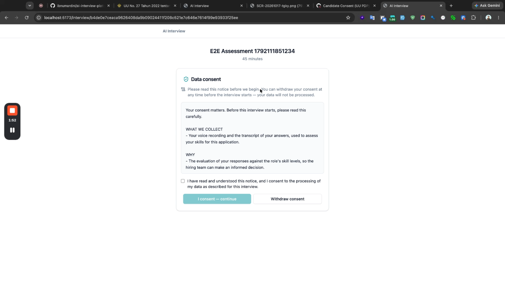
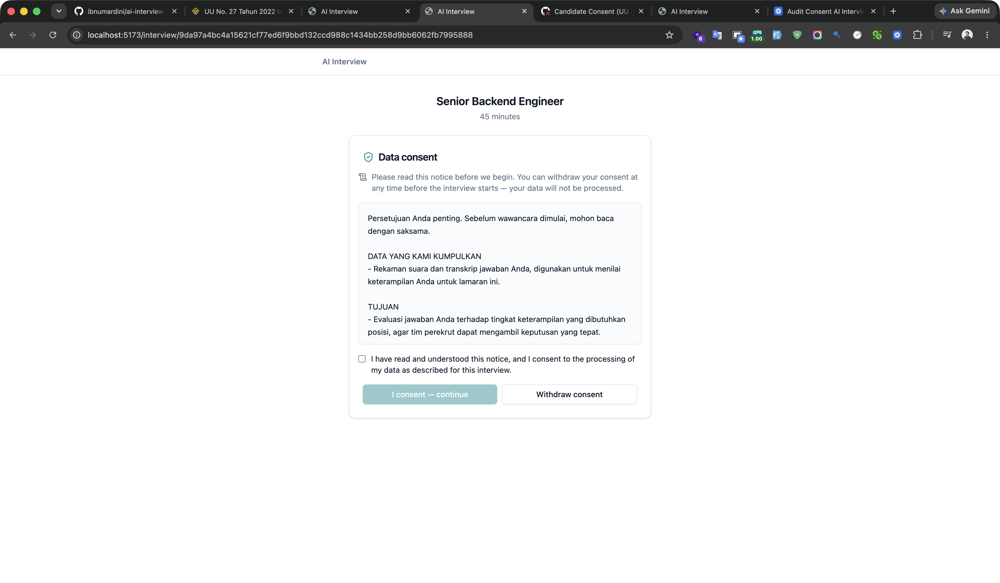
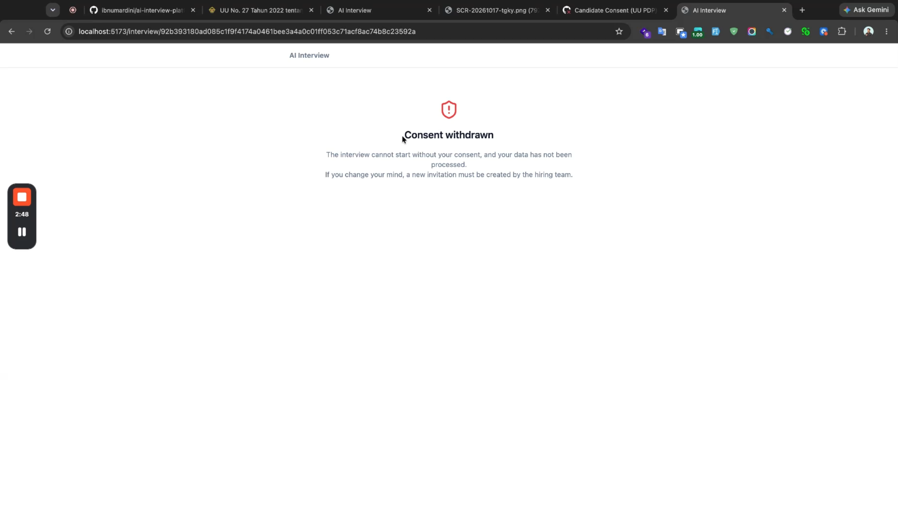
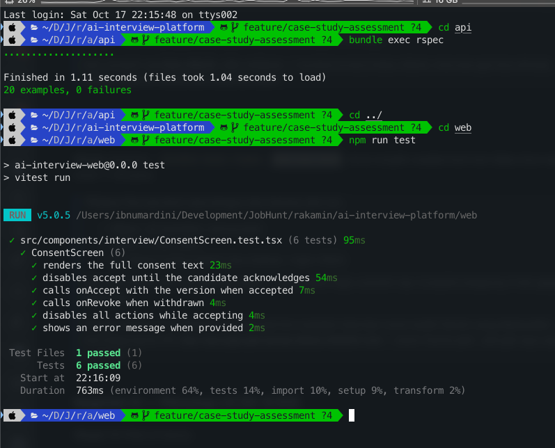

# AI Interview Platform — Case Study Report

**Fullstack Product Engineer — Rakamin**
**PR:** https://github.com/rakamindev/ai-interview-platform/pull/163
**Video:** https://www.loom.com/share/2284207a12854e4985a553d224977825
**Date:** 2026-10-17

---

## Step 1 — Setup & Local Exploration

Both services were run locally and explored end-to-end before any judgement.

| Service | Stack | Port |
|---|---|---|
| API | Rails 7 / PostgreSQL / Redis / Sidekiq / Gemini | 3001 |
| Web | React 18 + TypeScript / Vite / Tailwind / Radix | 5173 |

**Setup blockers found & resolved:**
- Ruby version mismatch (Gemfile pinned 3.3.2, toolchain 3.3.10) — bumped Gemfile
- Redis NOAUTH (local container requires auth) — local-only config fix
- macOS fork crash in Puma — launched with `OBJC_DISABLE_INITIALIZE_FORK_SAFETY=YES`
- No seeded users — JWTs minted manually for local dev

**Baseline confirmed (as the brief stated):** no RSpec specs, no web test runner, no CI.

---

## Step 2 — Deep Context & Domain Immersion

### The product
A voice-based AI skills assessor: the assessor configures a role + skills (L1–L5 behavioral anchors), the candidate talks to Gemini Live over audio WebSocket, a coverage map tracks which skills have been probed live, and after the session Gemini Pro produces an L1–L5 portfolio with evidence quotes, compared against a vacancy (fit/gap), exportable to PDF.

### The industry (hiring in Indonesia)
Hard: volume, inconsistent interviewer probing, little behavioral evidence, senior roles need deep probing. Commoditized: coding quizzes (HackerRank), ATS filtering, one-way video answers. The real leverage this product occupies: adaptive, probed, voice-based behavioral assessment against an explicit L1–L5 rubric with citable evidence.

### Users
- Assessor — wants a trustworthy per-candidate skill profile with evidence, and the ability to override AI ratings (human-in-the-loop).
- Recruiter — wants async, self-serve assessment they don't schedule.
- Hiring manager — wants one answer: fit/gap vs the role, in an exportable form.

### Candidates & UU PDP (UU 27/2022)
Candidates never chose this product; a wrong rating changes a real person's year. Voice is biometric (specific) data; automated rating is a decision candidates may object to (Pasal 10); Gemini is a cross-border transfer (Pasal 56). This drives the chosen revamp.

---

## Step 3 — Problem & Gap Analysis

Full findings in `assessment/03-step3-problem-gap.md`. Highlights:

| Sev | Finding | Type |
|---|---|---|
| P0 | Invite link points to API not frontend — candidates can't start | defined but broken |
| P0 | Interview session auto-ends with error — deprecated Gemini model + keys without Live access | defined but broken |
| P0 | No test harness (API + web + CI) | never defined |
| P0 | UU PDP non-compliance — no consent, plaintext transcripts, token in URL, no audit | never defined |
| P1 | Auth trusts JWT claims without DB lookup; no users; admin-only login | defined but broken |
| P1 | Portfolio generation fails without recovery | defined but broken |
| P1 | Worker idempotency / auto-advance can mis-rate | never defined |
| P1 | Candidate UI shows "Completed" for failed sessions | defined but broken |
| P2 | B7 skill loses skill_id; signup dead route; no 404 page; create-session no error handling; deprecated model config in docs | mixed |

**Constraint signal:** Gemini Live is paid/licensed; end-to-end interview verification is blocked (documented). Test infra must be built from zero. UU PDP needs product/legal decisions beyond code.

---

## Step 4 — Revamp Strategy

**Chosen scope: Candidate consent (P0-4).** Highest legal + fairness impact; fully implementable without a paid Gemini Live key; spans backend + frontend.

**Self-derived acceptance criteria (13 + 4 revoke cases)** — see `assessment/04-step4-revamp-strategy.md`: consent screen before interview, accept/decline/withdraw flows, idempotency, version mismatch, ended-session 409, unknown-token 404, proof record (version/timestamp/hash), EN/ID localization, revoked-on-refresh guard.

**Options evaluated:**
- **A. Columns on `sessions` (chosen)** — smallest change satisfying Pasal 20/22/24 proof; natural 1:1 with the candidate session; low walk-back cost.
- **B. Separate `candidate_consents` table** — richer audit history but premature: no candidate identity yet, no consumer of the history.
- **C. Disclaimer-only (rejected)** — fails Pasal 24 proof-of-consent; it *is* the defect we're fixing.

---

## Step 5 — Monozukuri Implementation

Full details in `assessment/05-step5-implementation.md`.

### Shipped
- **Backend:** consent migration (reversible), `Session#grant_consent!`/`#revoke_consent!`, `POST consent` + `consent/revoke` endpoints, `candidate_info` returns consent metadata + localized notice, `StartHandler` raises `ConsentRequired` (WS surfaces it, session never activates).
- **Frontend:** `ConsentScreen` component, `InterviewPage` gate (accept / withdraw / revoked), revoked-on-refresh guard.
- **Harness:** RSpec (20 examples) + Vitest (6 tests) + GitHub Actions CI (RSpec + Vitest + tsc).

### Proven correctness
- `bundle exec rspec` → 20 examples, 0 failures
- `npm run test` → 6 tests, 0 failures
- `tsc --noEmit` → clean

### Seeded fault test
Seeded `consent_status: 'none'` instead of `'given'` in `grant_consent!` → **3 specs failed** → reverted → 20 pass. The suite genuinely catches regressions.

### AI verification moments (3)
1. "Just change the model" hypothesis disproved by direct API testing — all provided keys lack Gemini Live access; the real blocker is licensing, not the model name.
2. First `json_error` implementation passed a hash as `message`; the RSpec request spec caught the broken response shape, forcing a string fix.
3. Early "l1 anchor missing" misdiagnosis corrected after re-reading `CustomSkillForm`.

### Screenshots (revamped UI)

**Consent screen (EN):**

**Consent screen (ID):**

**Revoked state — interview blocked:**

**Test harness passing (RSpec + Vitest):**

---

## Step 6 — Submission

- **PR:** https://github.com/rakamindev/ai-interview-platform/pull/163
- **Video walkthrough:** https://www.loom.com/share/2284207a12854e4985a553d224977825
- This PDF + screenshots + video per the brief's checklist.